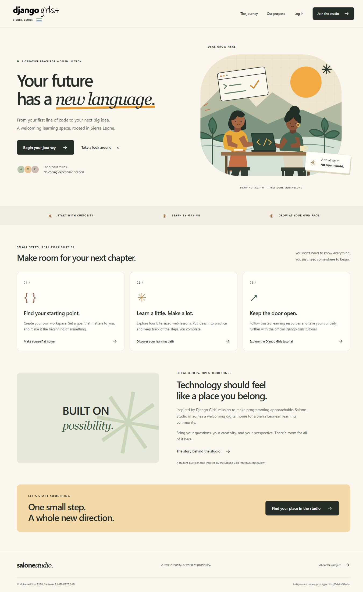

## Salone Studio PHP Authentication System and Dashboard

Web Programming Assignment 1 | Limkokwing University Sierra Leone

Student: Mohamed Sow | ID: 905004376 | Programme: BSEM | Semester: 5 | Year: 2026

## Project purpose and local context

Salone Studio is an independent student prototype for a Django Girls learning community in Sierra Leone. It combines account registration, secure login, a personalised dashboard and logout with a practical web learning path. The dashboard uses saved account data and lesson completion records, giving personalised information a useful purpose.

The official Django Girls Freetown page documents a workshop held in October 2017. That local connection informs the concept. The portal does not claim to announce a current workshop, represent the organisation officially, or award qualifications. Its purpose is a student-built learning space with working authentication and account-specific information.

## Visual identity and design choices

The official Django Girls logo appears at the top of every page. Warm orange references the organisation’s identity, while paper backgrounds, charcoal text and sage green make the learning space feel approachable. The Salone Studio name, restrained Sierra Leone flag detail, Freetown coordinates and original coast-and-hills illustration establish a local identity.

Strong headings, generous spacing and consistent dark action buttons make the next step clear. Segoe UI and Tahoma provide readable local system typography; Georgia adds an editorial accent. The five-page report uses embedded Tahoma at 12 points. No purchased theme, UI framework, third-party plugin or remote font service is used.

The custom SVG illustration depicts two women making a website together. It remains sharp on different screens and loads locally. The project prioritises an encouraging learning experience and avoids invented community statistics or workshop bookings.

---

## Home page screenshot

Figure 1 shows the complete desktop home page captured from XAMPP Apache. Desktop and mobile screenshots are included with the repository.

---

## Page structure and user experience

The home page introduces the purpose and a three-step journey before asking visitors to register. A clear call to action opens signup. The same header, logo and student copyright footer continue across public and signed-in pages, making navigation predictable.

Signup asks for a full name, email, learning goal, password and confirmation. Required fields and browser constraints give immediate guidance, while the server checks every submission independently. Invalid values return readable feedback without repopulating passwords. Duplicate email addresses are rejected, including case variations.

After registration, the user is redirected to login with a confirmation message. Successful login opens a protected dashboard with the user’s name, learning goal, completion percentage and recent activity. A new account starts at zero completed lessons. The next-step card points to the first unfinished lesson.

Four original lessons cover HTML, CSS, PHP and authentication security. Each contains explanations, a code example, a practice challenge and a server-checked question. A correct answer saves one completion record. Progress persists after logout; completing the same lesson twice does not increase the total. This is a learning check rather than a certificate.

The profile page updates the learner’s name and goal. The resource shelf links to official Django Girls, MDN, PHP and GitHub materials. These open in a new tab, leaving the workspace available. Logout is a deliberate button action that ends the session and returns to login.

## Responsive and accessible presentation

Desktop layouts pair text with illustration and use a sidebar for the workspace. On a phone, the hero, forms and cards stack, and the sidebar becomes compact navigation. Controls have labels, visible keyboard focus and clear errors. Completion is identified by text as well as colour. A skip link leads to main content, decorative icons are hidden from assistive technology and reduced-motion preferences are respected.

Every form is handled by PHP without JavaScript. Local artwork and system fonts avoid external requests. The application runs from htdocs through XAMPP Apache; MySQL must be running for account and progress reads and writes.

---

## Implementation and account security

Plain PHP handles requests and renders HTML. Shared bootstrap and view functions avoid repeating authentication, database and layout logic. Lesson data is an array; loops render the learning path, while conditional statements select completed states, validation feedback and the next lesson. This demonstrates variables, arrays, functions, loops, forms and sessions.

PDO uses native prepared statements to connect to XAMPP MySQL/MariaDB. Import database/schema.sql through phpMyAdmin before use. Users, progress and activity are linked by foreign keys; a unique email constraint prevents duplicate accounts. All database operations require the running MySQL server.

## Password and database protection

Registration stores the output of password_hash with PASSWORD_DEFAULT. Login uses password_verify, and password_needs_rehash upgrades hashes when necessary. Plain passwords are not stored in the database or activity history. The password length is limited to 72 bytes to avoid bcrypt truncation.

Prepared statements keep user values separate from SQL instructions. The e helper applies htmlspecialchars before account values enter HTML, preventing a stored name from becoming executable markup. Account IDs for progress and profile queries come from the authenticated session, not a submitted user ID.

## Session and request protection

Successful login regenerates the session identifier. Session cookies use HttpOnly and SameSite Lax; the Secure flag is enabled when the request uses HTTPS. Protected pages redirect anonymous users to login, and idle sessions expire after 30 minutes. Logout accepts POST only, verifies a session-bound CSRF token, clears session data, expires the cookie and destroys the stored session.

Registration, login, profile changes, progress and logout all validate a CSRF token. Login failures are limited through persistent account and IP buckets. Generic login errors avoid confirming an email’s existence. Security headers restrict scripts, framing and content interpretation. Responses containing account data are marked no-store.

The project is installed in C:/xampp/htdocs/salone-studio. Apache denies HTTP access to private folders using .htaccess. MySQL stores account records; storage holds private sessions excluded from Git. PHP rejects execution outside Apache. MySQL outages return HTTP 503 without a fallback database. Public hosting would require HTTPS and restricted database credentials.

---

## Verification and assessment evidence

The PHP integration suite passed 50 checks through running XAMPP Apache and MySQL. It submits real HTTP forms and verifies records, then removes its own test data. Coverage includes registration, hashes, session rotation, private-folder protection, CSRF, progress, account isolation, escaping, logout, expiry, throttling and SQL injection resistance. All PHP files passed syntax checks.

Browser screenshots document the Apache-served home, signup, login and dashboard. Desktop and phone layouts were reviewed. An actual request while MySQL was stopped returned HTTP 503; database-dependent work resumed only after MySQL restarted. These checks provide coursework evidence, not a production security certification.

| Criterion | Marks | Evidence |
| --- | --- | --- |
| Logo display | 2 | Shared header with official logo |
| Login and signup | 20 | Validated forms and hashed accounts |
| Logout | 10 | POST, CSRF and session destruction |
| Dashboard design | 5 | Goal, progress, lessons and activity |
| Security and experience | 5 | Protected requests and responsive UI |
| Footer | 3 | Student fields from site configuration |
| Screenshot documentation | 5 | Home screenshot and five-page report |

## Sources and asset credits

[Django Girls Freetown community page](https://djangogirls.org/de/freetown1/)

[Official Django Girls logo resources](https://github.com/DjangoGirls/resources)

[PHP manual on password hashing](https://www.php.net/manual/en/function.password-hash.php)

The logo remains Django Girls’ property; its resource terms request permission for non-organiser reuse. Illustration and layout are original to this project. AI assistance was used and should be disclosed according to university policy. The footer and report identify Mohamed Sow, student ID 905004376. The student must review the implementation and personally sign the lecturer’s assessment form.
